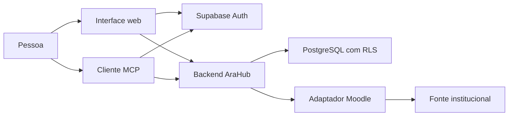

# Arquitetura

O AraHub separa quatro responsabilidades: identificar a pessoa, organizar sua
memória, consultar fontes e apresentar operações para um cliente. Essa separação
permite trocar a configuração de uma instalação sem inserir dados pessoais no
código e desenvolver adaptadores sem reescrever a memória.

## Caminho de uma requisição

A interface é estática. O navegador recebe HTML, CSS e JavaScript e obtém apenas
configuração pública da API. O Supabase Auth autentica a pessoa. A aplicação usa
o token de sessão para chamar o backend. O cliente MCP passa por OAuth e também
apresenta um token; o AraHub verifica adicionalmente se o cliente foi autorizado.

O backend hospedado é uma Edge Function. `src/edge.ts` normaliza o caminho recebido
do gateway e aplica a origem exata da interface. `src/http.ts` apresenta as APIs e
encaminha o MCP. `src/auth.ts` verifica assinatura, emissor, público, papel,
identidade e sessão ativa. A sessão é conferida no servidor, para que um token
assinado não permaneça suficiente depois de revogação.

## Isolamento entre contas

O dono vem da identidade validada. Ele não é escolhido por um campo de formulário
ou por `user_metadata`. `src/db.ts` executa operações com o papel autenticado e
os claims da pessoa dentro de uma transação. As políticas de segurança por linha
(RLS) restringem os registros a `auth.uid() = owner_id`.

As relações também incluem o proprietário. Uma referência a um arquivo, entidade
ou conexão de outro dono não se torna válida só porque seu UUID é conhecido. O
mesmo cuidado vale para leituras, escrita, exportação, transferências, ações e
reaproveitamento de binários.

As credenciais institucionais ficam em esquema privado, cifradas e fora da API de
dados. O cliente recebe resultados permitidos, não a chave de acesso ao Moodle.
O administrador da infraestrutura tem uma responsabilidade distinta dos usuários
comuns: acesso administrativo não deve ser confundido com ausência de capacidade
de ler o banco. Consulte [privacidade](privacidade.md).

## Como a memória é organizada

| Conceito | Responsabilidade |
| --- | --- |
| Conexão | Vincular um dono a uma conta/origem e ao estado de acesso correspondente. |
| Entidade | Identificar um curso, atividade, discussão, recurso ou artefato no grafo. |
| Observação | Conservar o conteúdo observado, sua origem e cobertura. |
| Contexto | Agrupar o trabalho que a pessoa pretende retomar. |
| Delta | Registrar um acréscimo ou correção versionada de memória. |
| Relação | Explicar como duas entidades se conectam e a evidência desse vínculo. |
| Arquivo | Manter nome, tipo, hash, versão e referência aos bytes preservados. |
| Ação | Preparar, revisar, executar e reconciliar uma operação externa específica. |

Uma chave de idempotência identifica a mesma tentativa lógica. A versão esperada
protege uma atualização contra concorrência. O sistema não escolhe silenciosamente
uma das versões quando duas intenções divergem. Os contratos aprofundados estão
em [memória](MEMORIA.md) e [acontecimentos](ACONTECIMENTOS-ACADEMICOS.md).

## Arquivos e representações

O AraHub guarda binários no PostgreSQL. Eles não ocupam um bucket do Supabase
Storage na implementação corrente. A referência de arquivo e o conteúdo são
responsabilidades diferentes: várias referências do mesmo dono podem apontar
para bytes idênticos, sem perder os vínculos acadêmicos.

Texto extraído, transcrição e síntese são representações com evidência própria.
Seu armazenamento não substitui o original. As leituras validam dono e hash;
transferências grandes usam partes limitadas. [Armazenamento](armazenamento.md)
detalha deduplicação e métricas. [Processamento](PROCESSAMENTO-MATERIAIS.md)
explica cobertura e limites dos formatos.

## Fontes e ações

O adaptador Moodle traduz capacidades específicas da instituição para contratos
do AraHub. Ele restringe operações e valida destinos de rede. URLs recuperadas
não podem ser usadas livremente para acessar recursos internos. Páginas e arquivos
são dados não confiáveis para fins de autorização.

Uma leitura não concede permissão para escrita. Uma ação preparada tem conteúdo,
destino e hash; a revisão autenticada aprova aquela versão por tempo limitado.
Antes de cruzar a fronteira externa, o sistema registra a intenção. Se a resposta
se perder, conserva estado incerto e exige reconciliação antes de reenviar.

## Configuração e extensibilidade

As URLs de API, interface e identidade são configuração da instalação. Os métodos
de login também são configuráveis; o Auth continua responsável por permitir ou
recusar cadastros. A autenticação da pessoa no AraHub é independente de sua
conexão institucional.

Para acrescentar uma fonte, defina identidade, capacidades, proveniência, paginação,
limites, revogação e semântica das falhas. Depois prove o contrato em ambiente
controlado e, separadamente, no provedor real. Não basta acrescentar um nome à
lista de provedores. O [guia do desenvolvedor](guia-do-desenvolvedor.md) orienta a
validação e [CONTRIBUTING](../CONTRIBUTING.md) define a entrega.
